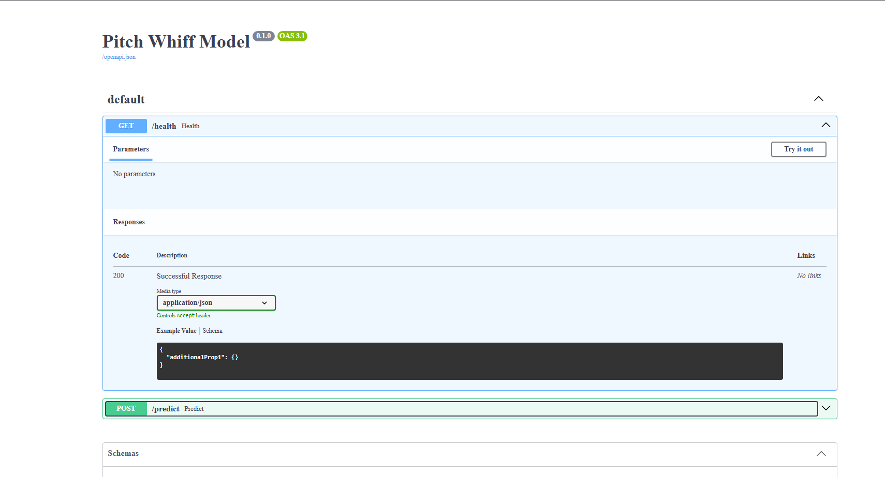
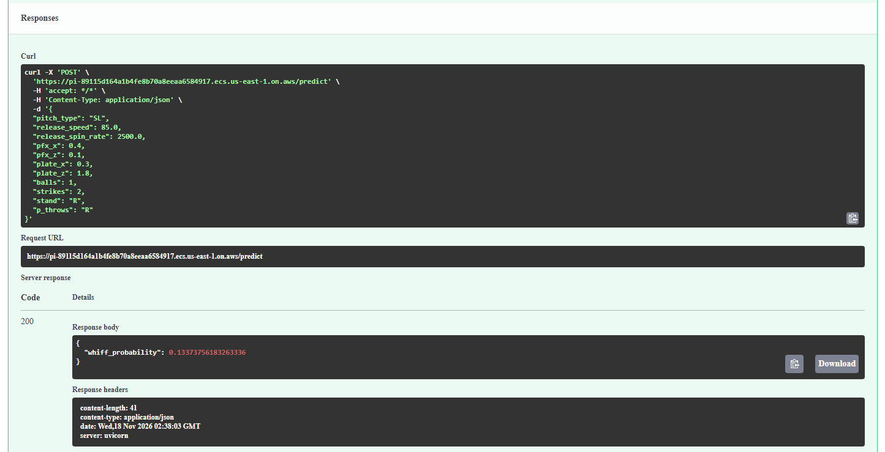

# Pitch Sequencing: Does the Previous Pitch Predict a Whiff?


A pitch-level machine learning project on MLB Statcast data, taken from research question to a tested, containerized API deployed on AWS.

**The question:** how much does knowing the *previous* pitch add to predicting a swing-and-miss, beyond what the current pitch already tells you (speed, movement, location, count)?

**The answer (short version):** very little. A model that sees only the current pitch reaches ROC AUC 0.768 on a held-out final month, and adding sequence features did not beat it under a decision rule I fixed in advance. The shipped model is the simpler one.

**Live demo:** https://pi-89115d164a1b4fe8b70a8eeaa6584917.ecs.us-east-1.on.aws/docs
(Interactive API docs. This runs on my AWS account and may be offline when you read this; screenshots are below and everything runs locally with one Docker command.)




## Contents

- [Results](#results)
- [How the model was chosen](#how-the-model-was-chosen)
- [Architecture](#architecture)
- [Run it locally](#run-it-locally)
- [API](#api)
- [Testing and CI](#testing-and-ci)
- [Deployment on AWS](#deployment-on-aws)
- [Design decisions](#design-decisions)
- [Project structure](#project-structure)
- [Limitations](#limitations)
- [Roadmap](#roadmap)

## Results

Data: the 2026 MLB regular season from Statcast. Unit of analysis is the **swing**. The target `whiff` is 1 if the swing missed (`swinging_strike`, `swinging_strike_blocked`, `missed_bunt`, `foul_tip`, matching Baseball Savant's convention). Train on pitches before 2026-09-01, test on everything from 2026-09-01 on.

| Model | ROC AUC | Log loss |
|---|---|---|
| Baseline (always predict the training whiff rate) | 0.500 | 0.5637 |
| **Model A** (current pitch only, 11 features), **shipped** | **0.7678** | **0.4645** |
| Model B (Model A plus 7 sequence features) | 0.769 | 0.464 |

- Pitch characteristics carry real signal: Model A cuts log loss from 0.564 to 0.465 versus the constant baseline.
- Sequence features (previous pitch type, speed change, location change, previous whiff, and so on) did not improve the model enough to justify shipping. Bootstrap interval for the log-loss difference (B minus A): -0.0007.
- Sequence features gave a tiny aggregate gain (about 0.0007 log loss, 0.001 AUC), small compared with how much the model gains from the current-pitch features alone.
- Under the pre-registered rule, that was not enough to ship: Model B did not beat A on every seed, so Model A ships.

## How the model was chosen

To avoid picking whichever model happened to look better, I wrote the decision rule **before** running the final comparison:

> Ship Model B only if it beats Model A on **every** random seed **and** the bootstrap range of the log-loss difference lies **entirely below zero**.

Model B did not clear that bar, so Model A ships. That is the finding, and it comes out of a rule I could not bend after seeing the numbers.

Both models use identical settings (`HistGradientBoostingClassifier`, `categorical_features="from_dtype"`, `random_state=42`), so the only difference is the feature set.

## Architecture

```
Statcast parquet files
        |
        v
  src/pitchmodel/  (data -> features -> train -> predict)
        |
        v
  models/whiff_model_a.joblib  +  models/metrics.json
        |
        v
  FastAPI app (/health, /predict)  -- Pydantic validation
        |
        v
  Docker image (python:3.13-slim, non-root user)
        |
        +--> GitHub Actions: tests, then build image and smoke-test /health
        |
        +--> Amazon ECR --> Amazon ECS (Express Mode, Fargate) --> HTTPS endpoint
```

## Run it locally

### Option 1: Docker (fastest)

```bash
docker build -t pitchmodel .
docker run --rm -p 8000:8000 pitchmodel
```

Open http://localhost:8000/docs.

### Option 2: Python environment (Windows PowerShell shown)

```powershell
python -m venv .venv
.venv\Scripts\Activate.ps1
pip install -e ".[dev]"
pytest -q
uvicorn pitchmodel.api:app --reload
```

Requires Python 3.10 or newer.

### Retrain from raw data

Put Statcast parquet files named `statcast_*.parquet` in `data/` (pulled with [`pybaseball`](https://github.com/jldbc/pybaseball); see `scripts/`), then:

```powershell
python -m pitchmodel.train
```

This rebuilds the features, fits Model A, evaluates on the held-out period, and writes `models/whiff_model_a.joblib` and `models/metrics.json`.

## API

`GET /health` returns `{"status": "ok"}`.

`POST /predict` takes one pitch and returns the probability that a swing at it misses.

```bash
curl -X POST "http://localhost:8000/predict" \
  -H "Content-Type: application/json" \
  -d '{"pitch_type":"SL","release_speed":85.0,"release_spin_rate":2500.0,"pfx_x":0.4,"pfx_z":0.1,"plate_x":0.3,"plate_z":1.8,"balls":1,"strikes":2,"stand":"R","p_throws":"R"}'
```

```json
{"whiff_probability": 0.1337}
```

Inputs are validated with Pydantic: pitch type must be a known code, counts must be legal (balls 0 to 3, strikes 0 to 2), handedness must be `L` or `R`, and physical quantities are range-checked. Invalid input returns a `422` with the reason instead of reaching the model.

## Testing and CI

34 tests cover feature engineering, training, prediction, schema validation, and the API.

```bash
pytest -q
```

GitHub Actions runs on every push with two jobs:

1. **test**: installs the package and runs the full test suite.
2. **docker**: builds the image, starts the container, and waits for `/health` to return OK. This catches problems that unit tests cannot, such as a missing model file in the image.

## Deployment on AWS

The image is pushed to **Amazon ECR** and run on **Amazon ECS in Express Mode**, which provisions a Fargate service, an Application Load Balancer, and an HTTPS endpoint. The container listens on port 8000 and the load balancer health-checks `/health`.

I deployed with the CLI and console rather than infrastructure-as-code. Codifying it (Terraform or CDK) and having CI push images to ECR automatically are on the roadmap.

## Design decisions

- **Time-based split, not random.** Pitches in the same game and by the same pitcher are highly correlated, so a random split leaks information and inflates scores.
- **Sequence features built before filtering to swings.** Lags are computed with `groupby(["game_pk", "at_bat_number"]).shift(1)` on the full pitch sequence. Filtering to swings first would make "previous pitch" mean "previous swing" and silently corrupt the feature.
- **Decision rule fixed in advance** (see above), so the model choice can't drift with the results.
- **Saved model is tied to its scikit-learn version.** Dependencies are pinned so the image loads the artifact it was trained with.
- **Container hygiene.** Slim base image, non-root user, `.dockerignore` keeps data and notebooks out of the image, binds to `0.0.0.0` so the port is reachable.
- **Model loaded once at startup** via the FastAPI lifespan hook, not on every request.

## Project structure

```
pitch-sequencing-model/
├── src/pitchmodel/
│   ├── config.py        # paths, feature lists, constants
│   ├── data.py          # load and filter Statcast parquet files
│   ├── features.py      # target, sequence features, swing filter, date split
│   ├── train.py         # fit, evaluate, save/load model; python -m pitchmodel.train
│   ├── predict.py       # single-pitch prediction
│   ├── schemas.py       # Pydantic request/response models
│   └── api.py           # FastAPI app
├── tests/               # pytest suite (34 tests)
├── models/              # trained model + metrics.json
├── notebooks/           # exploration and the original analysis
├── .github/workflows/   # CI
├── Dockerfile
└── pyproject.toml
```

## Limitations

- **One season of data.** Small effects need more, and this is why a real sequencing effect could still hide below the noise.
- **No pitcher or batter identity** in the model, so pitcher quality can masquerade as other effects.
- **The whiff target counts `foul_tip` as a whiff** to match Baseball Savant. Other definitions would shift the rates slightly.
- **The deployed endpoint is a demo.** It has no authentication or rate limiting.

## Roadmap

- **Tunneling (v2):** compute where consecutive pitches are at the batter's decision point from Statcast release position, velocity, and acceleration, and test whether a smaller "tunnel gap" goes with more whiffs.
- A within-pitcher comparison to test whether the offspeed-after-fastball gap survives controlling for who is pitching.
- Cluster bootstrap (resampling by game or pitcher) and per-month replication.
- Infrastructure-as-code for the AWS deployment, and CI that pushes to ECR automatically.
